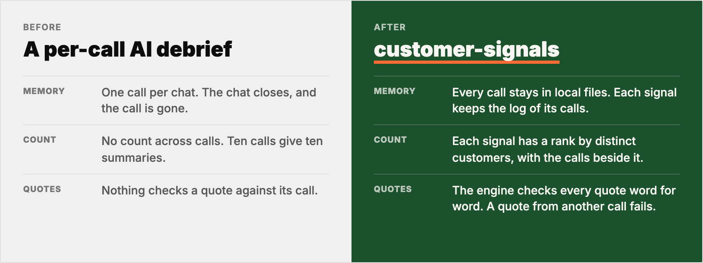
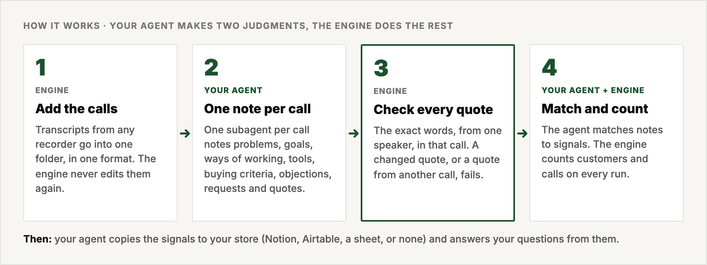

<h1 align="center">customer-signals</h1>

<p align="center">
  <strong>Turn your customer calls into a memory that your AI agent can ask.</strong>
</p>

<p align="center">
  
  
  
  
</p>

<p align="center">
  
</p>

Ask your agent *"what stops prospects from switching to us?"* or *"what do customers still do by hand?"*. It answers from all your calls, with a quote and the call for each point.

customer-signals keeps every call in local files. Your agent writes down what each customer says: problems, goals, ways of working, tools, alternatives, objections, requests and the words they use. It sorts these signals into pools for marketing, sales, product and customer service. A signal that more customers raise comes first.

> **AI agents:** read [`AGENTS.md`](AGENTS.md). It is the complete protocol.

---

## See it run

https://github.com/user-attachments/assets/26bc6bab-5cc2-4a33-84f2-c41b2a085f31

## Before and after

<p align="center">
  
</p>

One talkative customer on five calls counts as one customer. A customer is the company domain in the participant emails, then the customer name.

## How it works

<p align="center">
  
</p>

The agent makes two judgments: the note for each call, and which signals a note backs. The engine (`bin/cs`) does the rest:

1. `add` stores each transcript once, in one format, and never edits it again.
2. `check` tests every quote against its call: the exact words, from one speaker, in that call. A quote with changed words, or from another call, fails.
3. `plan` packs the new notes with the known signals for the agent to match.
4. `apply` checks the quotes again, writes the signals, and counts customers and calls from each signal's log. Counts are rebuilt on every run, so they cannot drift.

## What you get

| Where | What |
|---|---|
| `data/signals/INDEX.md` | Every signal, ranked by distinct customers, with calls, pools and the last date seen |
| `data/signals/<signal>.md` | One signal: a description, up to five checked quotes with speaker, customer and date, and a log of every call behind it |
| `data/notes/<call>.notes.md` | One call: customer context, pains, gains, their words, workflow, tools, decision, requests, quote bank, open questions |
| Your store | The signals with two or more customers, one row each, updated on every run |

Pools sort the signals by what they are about and whom they serve: marketing, sales, product, strategy, customer service, and others. Setup reads your project and proposes them. One signal can sit in several pools. Customer segments are optional.

The example in [`examples/ledgerly/`](examples/ledgerly/) shows all of it. It uses invented calls for a made-up invoicing app.

## Who it is for

| You are | You do today | customer-signals adds |
|---|---|---|
| A founder | You talk to customers and ask AI to debrief each transcript | One memory across all your calls |
| A marketer | You do not talk to customers and build messaging from AI research | Your customers' own words, counted and quoted |
| A product manager | You talk to customers but have no time to analyse each call | A ranked list for the hypotheses backlog |

It is not a call recorder. Your recorder makes the transcripts, and customer-signals reads them.

## Install with one message

Open your project in your AI agent and send:

```
Install https://github.com/4arkin/customer-signals, read its AGENTS.md,
and set up customer signals for this project.
```

Your agent then:

1. Reads your project and proposes pools, and segments if you have them. You approve them.
2. Finds your calls through your recorder's connector, its export, or a paste, and adds the last 10 to 30 calls.
3. Writes one note per call, checks every quote, and gives you the ranked list.
4. Copies the signals to your store and schedules the next run.

## Works with

- **Agents:** Claude Code, Codex, Gemini CLI, or any agent that can run commands in a folder.
- **Recorders:** any that gives a transcript. The engine reads `Name: text`, `**Name:** text`, timestamped lines, speaker-header blocks, WebVTT, SRT and plain text.
- **Stores:** any your agent has a connector for, such as Notion, Airtable or Google Sheets. Or none.
- **Python 3.9+**, standard library only. Nothing to install.
- **Cost:** nothing except the usage of your own agent. You need no API keys.

## FAQ

**Is this only about customer problems?**
No. A signal is any pattern that repeats across customers. It can be a problem, a goal, a way of working, a tool, a buying criterion, an objection or a request.

**Where do my calls go?**
Your local files are the source of truth. Your agent reads the calls. The signals go to the store you choose, or to none.

**What if the AI changes a quote?**
The quote fails the check. The engine accepts only the exact words, from one speaker, in that call. A quote from another call also fails.

**How does it count one customer?**
By the company domain in the participant emails, then by the customer name. One customer on five calls counts as one customer. A call with neither shows on the signal but does not count.

**Do I need customer segments?**
No. Segments are optional. Pools are the main sort, and setup proposes them from your project.

## Inside

| Path | What |
|---|---|
| [`AGENTS.md`](AGENTS.md) | The protocol your agent follows: setup, every run, answering questions |
| [`prompts/`](prompts/) | The setup interview, the note rules, the matching rules, how to answer |
| [`schedule/`](schedule/) | Agent-session, launchd and cron recipes |
| [`GOTCHAS.md`](GOTCHAS.md) | Known traps, and the fix for each |
| `bin/cs`, `cs/` | The engine |
| [`examples/ledgerly/`](examples/ledgerly/) | A full run on invented calls |
| `tests/` | `python3 -m unittest discover -s tests`, offline |

## License

MIT. See [`LICENSE`](LICENSE).
